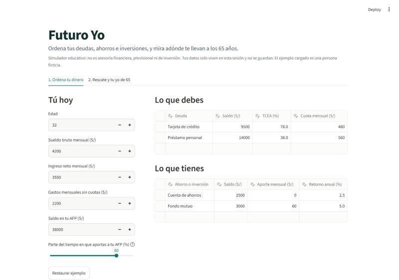
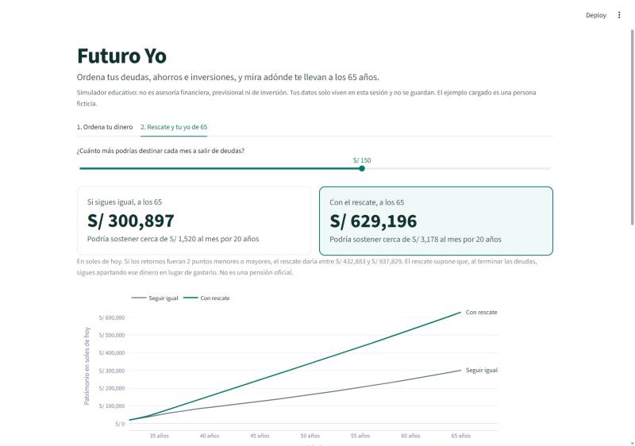
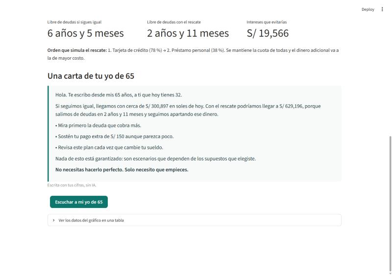
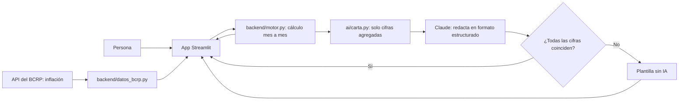

# Futuro Yo

> Simulador educativo. No es asesoría financiera, previsional ni de inversión. El perfil del demo es ficticio.

## 1. One-liner

**Futuro Yo ordena tus deudas, ahorros, inversiones y AFP en un solo lugar, y te muestra con cifras adónde te llevan a los 65 años.**

## 2. Founder

**[COMPLETAR: tu nombre]**. Economista. Diplomatura Q-Lab PUCP, proyecto final.

[COMPLETAR: en dos líneas, por qué te importa este problema.]

## 3. Problema

Quien tiene una tarjeta, un préstamo, algo de ahorro y un fondo de AFP ve cada cosa en una app distinta. Nadie le muestra cuánto le cuesta hoy su deuda en términos de su vida a los 65.

**Tres conversaciones reales** (notas en [`docs/research/`](docs/research/)):

- [COMPLETAR: conversación 1, qué descubriste]
- [COMPLETAR: conversación 2, qué descubriste]
- [COMPLETAR: conversación 3, qué descubriste]

## 4. Solución e insight

La persona registra lo que debe y lo que tiene. Futuro Yo calcula su situación actual, simula un plan para salir de deudas y proyecta dos caminos hasta los 65 años en soles de hoy. Al final recibe una carta de su yo de 65, que también puede escuchar.

**Insight:** una deuda se siente como una cuota de este mes. Cambiamos cómo se decide cuando esa cuota se traduce en el ingreso que tendrás a los 65.

## 5. Why now

- El reglamento de la Ley 32123, que moderniza el sistema de pensiones, ya se está implementando. Según prensa especializada, los aportes vinculados al consumo empiezan en enero de 2027. Las fechas deben confirmarse en las normas oficiales.
- La inflación de Lima fue 5.25 % a 12 meses en octubre de 2026, según el BCRP, y el dinero sin plan pierde valor real.
- Los modelos de lenguaje ya pueden explicar cifras en lenguaje humano a bajo costo, si el cálculo queda fuera del modelo.

## 6. Demo

**URL pública:** https://futuroyo.streamlit.app/

**Video de respaldo (60 a 90 s):** [COMPLETAR: enlace]

| Ordena tu dinero | Rescate y proyección | Carta de tu yo de 65 |
|---|---|---|
|  |  |  |

### Arquitectura



### Modelos y por qué

- **Motor financiero sin IA.** Las cifras deben ser exactas y reproducibles, y están cubiertas por pruebas en `tests/`.
- **Claude Opus 5.5 (`claude-opus-5-5`), opcional.** Solo redacta la carta en formato estructurado. Una revisión rechaza cualquier cifra que no venga del motor. Sin clave, o si falla, la app usa una plantilla.
- **Voz del navegador.** Lee la carta sin costo y sin enviar datos a otro servicio.

### Supuestos y límites

- La inflación por defecto es el promedio de 10 años del BCRP. Los retornos de AFP e inversiones son supuestos editables, no predicciones.
- El ingreso mensual a los 65 es una estimación educativa de 20 años con retorno real de 2 %. No es una pensión oficial.
- La proyección no incluye el pilar por consumo, la pensión mínima ni ningún retiro extraordinario de AFP.
- El rescate supone que, al terminar las deudas, la persona sigue apartando ese dinero. Si hoy gasta más de lo que gana, ese dinero cubre primero el faltante.

### Cómo correrlo

```bash
pip install -r requirements.txt
python -m backend.datos_bcrp
streamlit run app/streamlit_app.py
pytest
```

Para activar la carta con IA, copia `.env.example` a `.env` y agrega una clave con límite de gasto. En Streamlit Cloud va en *Secrets*. La clave nunca debe subirse al repositorio.

## 7. Modelo de negocio

Precios por validar.

| Plan | Quién paga | Precio |
|---|---|---|
| Personal | Nadie, es la puerta de entrada | Gratis |
| Bienestar financiero | Empleadores, por colaborador activo | S/ 9 al mes |
| Institucional | Cajas, cooperativas, bancos o AFP, con su marca | Desde S/ 3,000 al mes |

**Sector público:** programas de educación financiera de SBS, MEF o gobiernos locales, bajo la forma del plan institucional.

**Costo por usuario (estimado, aún no medido):** cerca de US$ 0.02 a 0.04 por carta con IA, según las tarifas de Claude Opus 5.5. El alojamiento del piloto es gratuito. El gasto de la API debe tener un límite mensual.

## 8. Herramientas del curso

| Herramienta | Sesión | Dónde está |
|---|---|---|
| APIs: BCRP en vivo con copia de respaldo | 03 | [`backend/datos_bcrp.py`](backend/datos_bcrp.py) |
| Dashboard interactivo y despliegue | 05 y 12 | [`app/streamlit_app.py`](app/streamlit_app.py) |
| LLM con salida estructurada y evaluación de cifras | 08 | [`ai/carta.py`](ai/carta.py), activa con clave de API |

## 9. Qué hizo el agente

Claude Code ayudó a investigar datos y normas, escribió la primera versión del motor, la app, las pruebas y este README, y probó la app en navegador. Durante esas pruebas detectó y corrigió un error: el rescate invertía dinero aunque la persona tuviera déficit.

[COMPLETAR: qué decidiste, cambiaste o verificaste tú.]

## Licencia

[MIT](LICENSE).
